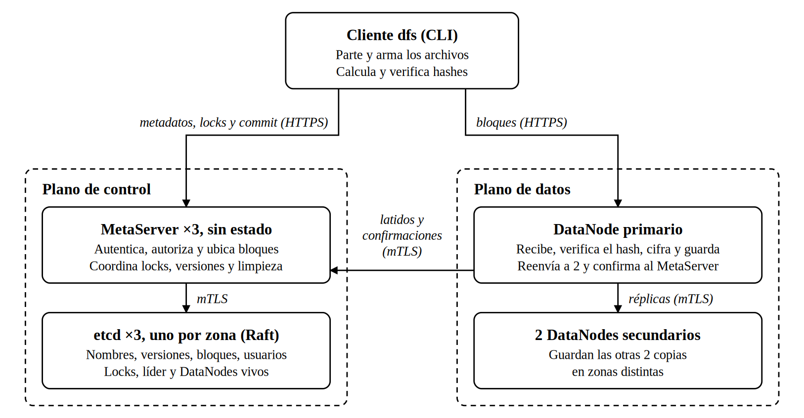
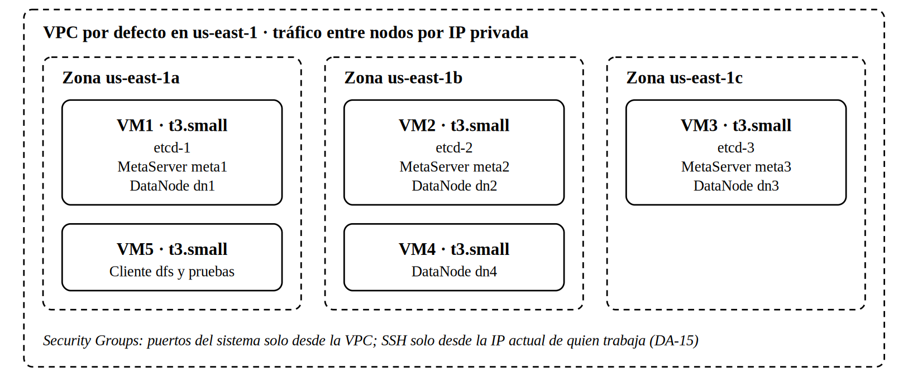

# DFSha

Sistema de archivos distribuido con alta disponibilidad, rendimiento y seguridad. Proyecto 1 de Sistemas Distribuidos (UPB, 2026-2), fase II, opción 1: cliente/servidor con servicio distribuido entre servidores (S2S), desplegado en 5 VMs de AWS Academy.

Equipo: Edwin David Vélez Rodríguez, José Elías Díaz Marín y Santiago Andrés Martínez Lora ([contribuciones](#equipo-y-contribuciones)).

## Contenido

1. [Qué es](#qué-es)
2. [Arquitectura](#arquitectura)
   - [Semántica de los archivos (RF3)](#semántica-de-los-archivos-rf3)
   - [Garantías](#garantías)
   - [Despliegue](#despliegue)
3. [Estructura del repositorio](#estructura-del-repositorio)
4. [Instalación](#instalación)
5. [Pruebas automáticas](#pruebas-automáticas)
6. [Correr en local](#correr-en-local)
7. [Despliegue en AWS](#despliegue-en-aws)
8. [Evidencias](#evidencias)
9. [Limitaciones conocidas](#limitaciones-conocidas)
10. [Equipo y contribuciones](#equipo-y-contribuciones)
11. [Contribuir](#contribuir)

Documentos de diseño: [decisiones de arquitectura](docs/decisiones.md) · [contrato de las APIs](docs/contratos.md) · [evidencias de las pruebas](docs/pruebas/README.md).

## Qué es

DFSha guarda archivos grandes repartidos en varios nodos. Cada archivo se parte en bloques de 8 MiB, y cada bloque queda en 3 DataNodes de al menos 2 zonas de disponibilidad. Los metadatos (nombres, versiones, dónde está cada bloque, usuarios y locks) viven en un clúster de etcd de 3 nodos, detrás de 3 MetaServers sin estado. El cliente `dfs` habla con los MetaServers para todo lo que es control y envía y recibe los bloques directamente de los DataNodes.

Lo que ofrece, según los requisitos del enunciado:

- **RF1, sistema de archivos jerárquico:** `ls`, `cd`, `pwd`, `mkdir`, `rmdir`, `rm` y `stat`, cada usuario en su propio espacio.
- **RF2, transferencia de archivos completos:** `dfs put` y `dfs get`, con los bloques en paralelo y el SHA-256 verificado.
- **RF3, acceso a archivos:** `open`, `read`, `write`, `close` y `lock`, con una semántica declarada: `w` crea o reemplaza, `a` anexa, `rw` modifica partes, y lo escrito se publica al cerrar (sección [Arquitectura](#semántica-de-los-archivos-rf3)).
- **Disponibilidad y consistencia:** un bloque se confirma con 2 copias en 2 zonas; si cae un DataNode o una zona completa, se sigue leyendo y escribiendo, y un líder repone las copias que faltan.
- **Seguridad:** TLS 1.3 en todo, TLS mutuo entre servidores, bloques cifrados en disco con AES-256-GCM, contraseñas con Argon2id, JWT de 1 hora y un pase firmado por cada bloque.

## Arquitectura

El diseño completo, con las 16 decisiones (DA-01 a DA-16), sus alternativas y su motivo, está en [`docs/decisiones.md`](docs/decisiones.md) (versión oficial en PDF en la misma carpeta). El contrato de las APIs, con cada ruta, mensaje, error y clave de etcd, está en [`docs/contratos.md`](docs/contratos.md), y el OpenAPI de cada API, en [`docs/api/`](docs/api/).



| Componente | Cuántos | Puertos | Qué hace |
|---|---|---|---|
| etcd | 3, uno por zona | 2379 (clientes), 2380 (entre nodos) | Guarda los metadatos con Raft; da los leases, el lock y la elección de líder (DA-01) |
| MetaServer | 3, uno por zona | 8443 (pública, HTTPS), 8444 (interna, mTLS) | Autentica y autoriza, ubica los bloques, coordina locks y versiones; uno de los tres es el líder, que repone copias y limpia bloques sin uso (DA-12, DA-02) |
| DataNode | 4 (dos en la zona b) | 9443 (pública, HTTPS), 9444 (interna, mTLS) | Guarda los bloques cifrados; el primario de cada bloque lo reenvía a 2 secundarios y confirma al MetaServer (DA-04, DA-09) |
| Cliente `dfs` | los que haga falta | — | CLI y `dfs shell`; parte y arma los archivos, y verifica los hashes |

Decisiones principales:

- **Bloques nombrados por su SHA-256** (DA-02) y de 8 MiB (DA-03): reintentar un envío no crea copias, una subida cortada se retoma y el DataNode verifica la integridad.
- **El primario reenvía** (DA-04): el cliente envía cada bloque una vez; el bloque se confirma con 2 copias en zonas distintas (W = 2), y el líder repone la tercera.
- **Ubicación por turnos** desde un inicio aleatorio por archivo (DA-05): los bloques de un archivo se reparten entre los 4 DataNodes.
- **REST sobre HTTPS** con FastAPI (DA-06) y **Python 3.12** (DA-07).
- **Un escritor por archivo** (DA-08): el lock es una fila de etcd con espera; el commit exige que la versión base siga siendo la actual y que el lock siga vivo.
- **Descubrimiento por etcd** (DA-11): el cliente solo conoce las IP de los 3 MetaServers y descubre los DataNodes en cada apertura.
- **Detección de fallos en dos pasos** (DA-12): latido cada 5 s, nodo caído a los 15 s, re-réplica a los 60 s; un líder nuevo espera 5 minutos antes de re-replicar.
- **Despliegue reproducible** (DA-13, DA-15) y **tiempos configurables** con `dfs status` para observar el sistema (DA-16).

### Semántica de los archivos (RF3)

| Modo | Al abrir | Lock |
|---|---|---|
| `r` | lee la versión que había al abrir; esa versión queda fija | no |
| `w` | crea o reemplaza: empieza vacío | sí |
| `a` | anexa: cada `write` va al final | sí |
| `rw` | modifica partes de la versión actual | sí |

`write(offset, datos)` acepta offsets entre 0 y el tamaño actual (sin huecos) y reescribe completos los bloques que toca. `close()` publica la versión nueva de una sola vez, y la versión reemplazada se conserva 10 minutos para los lectores que la tenían abierta (DA-14).

### Garantías

| Garantía | Enunciado |
|---|---|
| G1 Confirmación | `close()` o `put` responden éxito solo si cada bloque nuevo está en disco en al menos 2 DataNodes de zonas distintas, con hash verificado, y la versión quedó registrada en etcd |
| G2 Atomicidad | Un lector ve la versión v completa o la v+1 completa, nunca una mezcla |
| G3 Close-to-open | Todo `open()` posterior a un `close()` exitoso ve esa versión o una más reciente |
| G4 Sin escrituras perdidas | Un commit con versión base desactualizada o con el lock vencido se rechaza con 409 |
| G5 Durabilidad | Lo confirmado sobrevive a la caída de un DataNode o de una zona completa, y a la de dos DataNodes cuando el líder ya repuso la tercera copia |

### Despliegue



5 VMs t3.small en 3 zonas de us-east-1: tres de control (etcd, MetaServer y DataNode), una con el cuarto DataNode en la zona b y una para el cliente y las pruebas. Cada VM corre sus servicios con Docker Compose y la red del host.

## Estructura del repositorio

```
README.md
pyproject.toml          paquete dfsha y dependencias; pip install -e ".[dev]"
.env.example            variables de entorno con sus valores normales y de prueba (nunca secretos)
Dockerfile              una sola imagen para MetaServer, DataNode y cliente
compose.local.yml       el sistema completo en un PC, con TLS 1.3 y mTLS
compose.aws.yml         una VM de AWS: perfiles control, data y client (lo usa infra/deploy.sh)
docs/
  decisiones.md         decisiones de arquitectura (versión oficial en PDF al lado)
  contratos.md          contrato de las APIs: rutas, mensajes, errores, formatos y claves de etcd
  api/                  OpenAPI de cada API, generado desde el código
  img/                  figuras de decisiones.md
  pruebas/              evidencias de las pruebas (índice en su README.md) y sus datos en datos/
src/
  dfs_common/           modelos, errores, configuración, seguridad y arranque comunes
  metaserver/           MetaServer: API pública (8443) e interna (8444)
  datanode/             DataNode: API pública (9443) e interna (9444)
  dfs_client/           cliente: DfsApi y la CLI dfs
infra/                  scripts de AWS: create, allow-ssh, deploy, ssh, vm y destroy; config.sh
scripts/                export_openapi.py (OpenAPI) y gen_secrets.py (CA, certificados y secretos)
  pruebas/              scripts de prueba, iguales en local y en AWS
tests/                  pruebas automáticas (pytest)
```

Código del MetaServer (`src/metaserver/`):

| Módulo | Qué hace |
|---|---|
| `public_api.py` y `internal_api.py` | Rutas: el contrato HTTP. Solo llaman a los módulos de abajo |
| `etcd.py` | Cliente de etcd por la pasarela HTTP/JSON: claves y valores en base64, transacciones, leases, lock y elección |
| `deps.py` | Lo que se crea al arrancar (configuración, cliente de etcd, claves) y se entrega a las rutas |
| `auth.py` | Contraseñas Argon2id, `require_user` y `require_admin`, usuarios y primer administrador |
| `fs.py` | Directorios y archivos del espacio de cada usuario |
| `locks.py` | Locks de escritura: pedir (con espera y renovación), renovar, liberar y `resolve_lock` |
| `uploads.py` | Subidas: reserva, `realloc` y commit; `check_commit` valida la forma del archivo |
| `placement.py` | `choose_nodes`: a qué DataNodes va cada bloque (DA-05) |
| `blocks.py` | Claves de bloque: confirmación, `update_stored_on` y copias vivas en 2 zonas |
| `files.py` | `GET /files/blocks`: manifiesto, réplicas vivas y pases de lectura |
| `nodes.py` | DataNodes vivos de `/nodes/dn/` y comprobación de la IP de origen de la API interna |
| `datanodes.py` | Registro y latidos de los DataNodes, con sus órdenes |
| `metaservers.py` | Autorregistro de este MetaServer y lista de MetaServers vivos |
| `status.py` | `GET /admin/status`: `build_admin_status` arma la respuesta |
| `leader.py` | Elección del líder y sus vueltas; `plan_repairs` decide qué órdenes escribir |
| `gc.py` | Limpieza que corre el líder; `plan_gc` decide qué manifiestos y bloques borrar |
| `keys.py` | Formato de las claves de etcd (contrato, sección 8) |

Código del DataNode (`src/datanode/`):

| Módulo | Qué hace |
|---|---|
| `public_api.py` y `internal_api.py` | Rutas: el contrato HTTP. Solo llaman a los módulos de abajo |
| `deps.py` | Lo que se crea al arrancar (configuración, almacén y clave de los pases); las dos apps comparten el almacén |
| `storage.py` | `BlockStore`: guarda, lee y borra bloques cifrados en `DFS_DATA_DIR` |
| `auth.py` | `require_pass`: verifica el pase de bloque de cada petición |
| `primary.py` | `PUT /blocks/{hash}`: guardar, reenviar a los secundarios y confirmar |
| `meta_client.py` | `MetaClient`: descubre los MetaServers y les habla por mTLS |
| `agent.py` | `NodeAgent`: registro, latidos y órdenes, en tareas de fondo; `load_disk_id` lee o crea `DFS_DATA_DIR/.disk_id` |

Código del cliente (`src/dfs_client/`):

| Módulo | Qué hace |
|---|---|
| `api.py` | `DfsApi`: una llamada por ruta del contrato; descubre los MetaServers y pasa al siguiente si uno no responde |
| `session.py` | Sesión en `~/.dfs/session.json` (usuario, JWT y directorio actual); `Session.resolve` arma la ruta absoluta |
| `cli.py` | Comandos `dfs` con typer; el formato de la salida está en las funciones `format_*` |
| `files.py` | `DfsFile`: `open`, `read`, `write` y `close`; la semántica de RF3 está en su docstring |
| `shell.py` | `dfs shell`: `open`, `read`, `write`, `writefile`, `close`, `files` y `quit` sobre descriptores |
| `transfer.py` | `upload_version`, `fetch_block` y `download_file`: bloques en paralelo, con reintentos y verificación del SHA-256 |
| `locks.py` | `LockKeeper`: renueva el lock en un hilo mientras se escribe y avisa si se perdió |

Las decisiones de implementación que precisan el diseño están en las secciones 10 a 13 de `docs/contratos.md` y en el docstring inicial de cada módulo. Cuando nombran una tarea ("tarea 19"), la tabla de [contribuciones](#equipo-y-contribuciones) dice cuál fue.

## Instalación

El sistema se despliega con Python 3.12, dentro de Docker. Para desarrollar y correr las pruebas sirve Python 3.12 o más reciente: las pruebas también pasan en 3.13. Desde la raíz del repositorio:

**Windows (PowerShell)**

```powershell
py -3.12 -m venv .venv
.venv\Scripts\Activate.ps1
python -m pip install -e ".[dev]"
```

Si PowerShell no deja ejecutar `Activate.ps1`, corre antes `Set-ExecutionPolicy -Scope Process Bypass`.

**Linux**

```bash
python3.12 -m venv .venv
source .venv/bin/activate
python -m pip install -e ".[dev]"
```

Para correr el sistema hace falta además Docker con Compose v2: Docker Desktop en Windows, o Docker Engine con el plugin de Compose en Linux.

## Pruebas automáticas

Con el entorno activado, igual en Windows y en Linux:

```bash
pytest
```

`tests/test_contratos.py` comprueba que las rutas sean las del contrato, que los ejemplos de `docs/contratos.md` sean los de los modelos y validen, que las tablas de rutas, de errores y de variables coincidan con el código y con `.env.example`, y que `docs/api/` esté al día.

Las rutas del MetaServer se prueban con un etcd en memoria (`tests/fakes.py`). Las pruebas contra un etcd real (`tests/test_etcd_integration.py` y `tests/test_metaserver_integration.py`) se saltan si no está la variable `DFS_TEST_ETCD`. Para correrlas, desde PowerShell:

```powershell
docker run -d --rm --name etcd-test -p 2379:2379 -e ETCD_LISTEN_CLIENT_URLS=http://0.0.0.0:2379 -e ETCD_ADVERTISE_CLIENT_URLS=http://127.0.0.1:2379 quay.io/coreos/etcd:v3.5.35
$env:DFS_TEST_ETCD = "http://127.0.0.1:2379"; pytest; Remove-Item Env:DFS_TEST_ETCD
docker stop etcd-test
```

En Linux, la segunda línea es `DFS_TEST_ETCD=http://127.0.0.1:2379 pytest`.

**Regenerar el OpenAPI.** Después de cambiar un modelo, una ruta o un error, `python scripts/export_openapi.py` reescribe los cuatro JSON de `docs/api/`; si nadie cambió el código, quedan iguales. `fastapi` y `pydantic` tienen versión fija en `pyproject.toml` porque el OpenAPI generado cambia entre versiones.

**Documentación interactiva.** Sin TLS, en `http://127.0.0.1:8443/docs`:

```bash
uvicorn metaserver.public_api:app --port 8443 --lifespan off
```

`--lifespan off` hace falta porque, al arrancar, cada app lee sus secretos y se conecta a etcd o abre `DFS_DATA_DIR`. Así sirven `/docs` y `/health`; las demás rutas responden 500, porque no hay etcd, claves ni almacén. Las otras apps son `metaserver.internal_api:app`, `datanode.public_api:app` y `datanode.internal_api:app`.

## Correr en local

`compose.local.yml` levanta en un solo PC el sistema completo, con TLS 1.3 y mTLS reales y los mismos puertos que en AWS: 3 etcd, 3 MetaServers, 4 DataNodes y un contenedor cliente. Cada contenedor tiene una IP fija en la red `dfs` (`10.88.0.0/24`) y la zona de AWS que le corresponde en `DFS_ZONE`. En Windows funciona igual desde PowerShell, WSL o Git Bash; los scripts de prueba (bash) corren en WSL o en Git Bash.

| Contenedor | IP | Zona |
|---|---|---|
| etcd1, etcd2, etcd3 | 10.88.0.11, .12, .13 | us-east-1a, 1b, 1c |
| meta1, meta2, meta3 | 10.88.0.21, .22, .23 | us-east-1a, 1b, 1c |
| dn1, dn2, dn3, dn4 | 10.88.0.31, .32, .33, .34 | us-east-1a, 1b, 1c, 1b |
| client | 10.88.0.41 | us-east-1a |

**1. Generar la CA, los certificados y los secretos** (una sola vez; con el entorno de Python activado). Quedan en `secrets/local/`, que git ignora. Si la carpeta ya existe, el script no la toca; `--force` regenera todo, pero deja ilegibles los bloques guardados, así que después corre `down -v`.

```bash
python scripts/gen_secrets.py --out secrets/local --nodes etcd1=10.88.0.11,etcd2=10.88.0.12,etcd3=10.88.0.13,meta1=10.88.0.21,meta2=10.88.0.22,meta3=10.88.0.23,dn1=10.88.0.31,dn2=10.88.0.32,dn3=10.88.0.33,dn4=10.88.0.34
```

**2. Levantar todo:**

```bash
docker compose -f compose.local.yml up -d --build
docker compose -f compose.local.yml ps
```

Deben quedar 11 contenedores corriendo y los 3 etcd en `healthy`. Al arrancar, un MetaServer crea el usuario `admin` con la contraseña de `secrets/local/admin_password`; si etcd todavía no responde, el contenedor termina y Docker lo reinicia hasta que etcd esté listo. Un DataNode no arranca si `DFS_DATA_DIR` tiene bloques pero no `.disk_id` (contrato, sección 3): si pasa con volúmenes viejos, bórralos con `down -v` (paso 7). Los tiempos de DA-16 toman los valores normales; para usar los de prueba, crea un `.env` en la raíz (git lo ignora) con la columna "Pruebas" de `.env.example`, por ejemplo `DFS_RETENTION_S=60`.

**3. Comprobar TLS y mTLS:**

```bash
# API pública por HTTPS, verificada con la CA propia: {"status":"ok"}
docker compose -f compose.local.yml exec client curl --cacert /run/secrets/ca.crt https://10.88.0.21:8443/api/v1/health
docker compose -f compose.local.yml exec client curl --cacert /run/secrets/ca.crt https://10.88.0.31:9443/api/v1/health

# Solo TLS 1.3: con TLS 1.2 falla
docker compose -f compose.local.yml exec client curl --tls-max 1.2 --cacert /run/secrets/ca.crt https://10.88.0.21:8443/api/v1/health

# API interna (mTLS): sin certificado de cliente, el servidor corta el handshake
docker compose -f compose.local.yml exec client curl --cacert /run/secrets/ca.crt -X POST https://10.88.0.21:8444/api/v1/internal/register

# Con el certificado de un DataNode, el handshake pasa y responde JSON (400: falta el cuerpo)
docker compose -f compose.local.yml exec dn1 curl --cacert /run/secrets/ca.crt --cert /run/secrets/tls.crt --key /run/secrets/tls.key -X POST https://10.88.0.21:8444/api/v1/internal/register

# etcd: 3 miembros y los 3 sanos (etcdctl ya trae los certificados en sus variables ETCDCTL_*)
docker compose -f compose.local.yml exec etcd1 etcdctl member list -w table
docker compose -f compose.local.yml exec etcd1 etcdctl endpoint health --cluster
```

**4. Entrar como administrador por la API** (opcional: el paso 5 hace lo mismo con `dfs`). Responde `{"token": "...", "expires_in": 3600}`; la contraseña se lee del archivo y no se muestra.

PowerShell:

```powershell
$login = @{ user = "admin"; password = (Get-Content secrets/local/admin_password -Raw).Trim() } | ConvertTo-Json -Compress
$login | docker compose -f compose.local.yml exec -T client curl -s --cacert /run/secrets/ca.crt -H "Content-Type: application/json" --data-binary "@-" https://10.88.0.21:8443/api/v1/auth/login
```

WSL o Linux:

```bash
printf '{"user":"admin","password":"%s"}' "$(cat secrets/local/admin_password)" | docker compose -f compose.local.yml exec -T client curl -s --cacert /run/secrets/ca.crt -H "Content-Type: application/json" --data-binary @- https://10.88.0.21:8443/api/v1/auth/login
```

**5. Usar el cliente `dfs`.** Desde el contenedor `client`; la contraseña de `admin` está en `secrets/local/admin_password`. La sesión queda en `~/.dfs/session.json` del contenedor.

```bash
docker compose -f compose.local.yml exec client dfs login --user admin
docker compose -f compose.local.yml exec client dfs useradd ana
docker compose -f compose.local.yml exec client dfs status
docker compose -f compose.local.yml exec client dfs login --user ana
docker compose -f compose.local.yml exec client dfs mkdir /docs
docker compose -f compose.local.yml exec client dfs cd /docs
docker compose -f compose.local.yml exec client dfs ls
docker compose -f compose.local.yml exec client dfs rmdir /docs
```

Subir y bajar un archivo, y ver dónde quedó cada bloque. `put` y `get` muestran la versión, los bloques enviados y los MiB/s; `--parallel N` cambia cuántos bloques viajan a la vez (4 por defecto).

```bash
docker compose -f compose.local.yml exec client sh -c "head -c 64M /dev/urandom > /tmp/a.bin"
docker compose -f compose.local.yml exec client dfs put /tmp/a.bin /a.bin
docker compose -f compose.local.yml exec client dfs stat --blocks /a.bin
docker compose -f compose.local.yml exec client dfs get /a.bin /tmp/b.bin
docker compose -f compose.local.yml exec client sha256sum /tmp/a.bin /tmp/b.bin
```

Abrir un archivo, leer y escribir partes y publicar al cerrar (RF3), con descriptores. En dos terminales a la vez sirve para ver la concurrencia; dentro del shell, `help` lista los comandos.

```bash
docker compose -f compose.local.yml exec client dfs shell
# dfs> open /a.txt rw        responde el fd, por ejemplo 3
# dfs> write 3 0 hola
# dfs> read 3 0 100
# dfs> close 3               publica la versión nueva
```

`dfs --help` lista los comandos, y `dfs COMANDO --help` explica cada uno.

**6. Pruebas del sistema.** Los scripts de `scripts/pruebas/` corren en bash desde la raíz del repositorio, iguales en local y en AWS (`--env aws`), y terminan con `RESULTADO: PASA` o `FALLA`. El comentario del inicio de cada uno explica sus opciones.

```bash
scripts/pruebas/smoke.sh                  # humo: put y get de 512 MiB, copias, zonas y SHA-256
scripts/pruebas/smoke.sh --mib 64         # más rápido
scripts/pruebas/rf3.sh                    # RF3 con dos clientes (G2 y G3)
scripts/pruebas/perf.sh --sizes "1 16" --reps 2      # rendimiento, versión corta
scripts/pruebas/fallos.sh datanode        # dn4 se detiene durante un get y durante un put
scripts/pruebas/fallos.sh zona-c          # etcd3, meta3 y dn3 detenidos
scripts/pruebas/fallos.sh zona-b          # etcd2, meta2, dn2 y dn4 detenidos
scripts/pruebas/fallos.sh consistencia    # iptables corta el puerto 9444 de dn4 durante un put
scripts/pruebas/timeline.sh               # solo la línea de tiempo de dfs status, cada 5 s
```

`fallos.sh` deja la línea de tiempo en `docs/pruebas/datos/27-CASO-local.csv` y reemplaza la que hubiera; para no tocar las evidencias, usa `--csv` con otra ruta. Las pruebas de concurrencia y de seguridad se hacen a mano, con `dfs shell`, `dfs` y `curl`: los comandos están en `docs/pruebas/26-concurrencia.md` y `26-seguridad.md`.

**7. Apagar:**

```bash
docker compose -f compose.local.yml down      # conserva los datos de etcd y de los DataNodes
docker compose -f compose.local.yml down -v   # además borra los volúmenes con los datos
```

## Despliegue en AWS

El sistema corre en 5 VMs t3.small de us-east-1 (DA-13) y se maneja con los scripts de `infra/` (DA-15):

| VM | Zona | Corre |
|---|---|---|
| vm1, vm2, vm3 | us-east-1a, 1b, 1c | etcd, MetaServer y DataNode |
| vm4 | us-east-1b | el cuarto DataNode |
| vm5 | us-east-1a | el cliente `dfs` y las pruebas |

Cada integrante despliega en su propio Learner Lab: los scripts no tienen nada de una cuenta concreta. Las VMs se encuentran por sus etiquetas y las IP se leen cada vez. Las VMs construyen la imagen a partir del repositorio público, así que la máquina que despliega no necesita Docker. Los comandos van desde la raíz del repositorio: en Windows, en una terminal de WSL (Ubuntu); en Linux, en cualquier terminal (diferencias al final de esta sección).

**1. Preparar WSL (una sola vez).**

- AWS CLI v2: sigue https://docs.aws.amazon.com/cli/latest/userguide/getting-started-install.html (Linux x86_64).
- Python con `cryptography`, que usa `scripts/gen_secrets.py`: `sudo apt install python3-cryptography`.
- `ssh`, `scp`, `curl` y `git` ya vienen con Ubuntu.

**2. Credenciales y llave.**

1. En el Learner Lab, pulsa Start Lab y espera a que el círculo de AWS quede en verde.
2. Pulsa AWS Details y, junto a "AWS CLI", Show. Copia el bloque completo, desde `[default]`, en `~/.aws/credentials`, reemplazando lo que había (`nano ~/.aws/credentials`, pegar, Ctrl+O, Enter y Ctrl+X). Estas credenciales cambian en cada sesión.
3. Solo la primera vez: en AWS Details, Download PEM. Copia la llave a WSL, sin `sudo`, y déjala solo para ti. Si la copiaste con `sudo`, `sudo chown $USER: ~/.ssh/labsuser.pem`.

   ```bash
   cp /mnt/c/Users/<tu usuario de Windows>/Downloads/labsuser.pem ~/.ssh/labsuser.pem
   chmod 400 ~/.ssh/labsuser.pem
   ```

4. Comprueba las credenciales: `aws sts get-caller-identity` debe responder sin error.

**3. Crear las VMs (una sola vez).** Crea el grupo de seguridad y las 5 VMs, con discos gp3 cifrados, y abre el SSH solo a tu IP. Tarda alrededor de un minuto. Al arrancar, cada VM instala Docker y clona este repositorio.

```bash
./infra/create.sh
```

**4. Desplegar.** Genera en `secrets/aws/` (git lo ignora) la CA, los certificados con las IP privadas reales y los secretos. Después copia a cada VM solo lo suyo, monta el disco de etcd, levanta los contenedores y comprueba la salud. Termina con una lista de `ok` y el `dfs status` del sistema.

```bash
./infra/deploy.sh                       # rama main y tiempos normales de DA-16
./infra/deploy.sh --ref otra-rama       # otra rama o commit, que ya esté en GitHub
DFS_W=3 ./infra/deploy.sh               # valores de DA-16 distintos, sin tocar el código
./infra/deploy.sh --times scripts/pruebas/pruebas.env   # o desde un archivo con líneas DFS_X=valor
```

Para actualizar el código después de un cambio en GitHub, se corre `./infra/deploy.sh` otra vez: reutiliza los secretos y los datos.

**5. Usar el clúster.**

```bash
./infra/deploy.sh --check                                # solo la comprobación de salud
./infra/ssh.sh vm5 scripts/pruebas/smoke.sh --env aws    # prueba de humo, 512 MiB
./infra/ssh.sh vm5 scripts/pruebas/rf3.sh --env aws      # RF3 con dos clientes
./infra/ssh.sh vm5 scripts/pruebas/perf.sh --env aws --csv docs/pruebas/datos/25-rendimiento-aws.csv  # rendimiento
./infra/ssh.sh vm5                                       # entrar a la VM del cliente
./infra/ssh.sh vm4 docker compose stop dn                # detener dn4 a mano
./infra/ssh.sh vm4 docker compose start dn
./infra/vm.sh status                                     # estado de cada VM
./infra/vm.sh stop vm3                                   # detener una VM (aquí, la zona c) y esperar
./infra/vm.sh start vm3                                  # encenderla y esperar a que responda por SSH
```

Dentro de una VM, en `~/dfsha`, basta `docker compose ps`, `docker compose logs --tail 50 meta` o `docker compose stop dn`: el `.env` que escribió `deploy.sh` dice qué archivo y qué perfil usar. En la VM5, el cliente se usa como en local, sin `-f compose.local.yml`: `docker compose exec client dfs login --user admin`. La contraseña está en `secrets/aws/admin_password`, tanto en tu máquina como en la VM5.

**Pruebas de fallos.** `scripts/pruebas/fallos.sh` corre en la máquina que despliega, porque detiene VMs con la AWS CLI; su línea de tiempo (`timeline.sh`) corre en la VM5. Las pruebas usan los tiempos normales: después de un despliegue o de un cambio de líder, espera los 5 minutos de `DFS_LEADER_GRACE_S` antes de empezar.

```bash
scripts/pruebas/fallos.sh datanode --env aws
scripts/pruebas/fallos.sh zona-c --env aws
scripts/pruebas/fallos.sh zona-b --env aws
scripts/pruebas/fallos.sh consistencia --env aws
scripts/pruebas/fallos.sh sesion-antes --env aws     # después: End Lab, Start Lab, credenciales y ./infra/allow-ssh.sh
scripts/pruebas/fallos.sh sesion-despues --env aws   # lo antes posible después de Start Lab
```

**6. Al terminar de trabajar, End Lab.** Las VMs se detienen y los datos se conservan. Los discos cuestan unos US$9 al mes aunque estén detenidos; encendido, el clúster cuesta unos US$0,13 por hora.

**Retomar el clúster en una sesión nueva**

1. Start Lab: las VMs arrancan solas, y sus contenedores vuelven solos.
2. Renueva `~/.aws/credentials` (paso 2, punto 2).
3. `./infra/allow-ssh.sh`: si cambió tu IP pública, deja el SSH abierto solo a la nueva.
4. `./infra/deploy.sh --check`.

Si algo no está sano:

- **"no responde por SSH":** la VM puede seguir arrancando; espera un minuto. Si persiste, corre `./infra/allow-ssh.sh` otra vez.
- **etcd sin sus 3 miembros sanos:** `./infra/ssh.sh vm1 docker compose ps`, y `docker compose logs --tail 50 etcd` en la VM del miembro que falla. También `mountpoint /srv/dfsha/etcd` en esa VM: el disco de etcd tiene que estar montado.
- **Un MetaServer o un DataNode que no responde:** `./infra/ssh.sh vmN docker compose ps` y `docker compose logs --tail 50 meta` (o `dn`). Al arrancar, el MetaServer se reinicia solo hasta que etcd tiene mayoría; espera un minuto y repite `--check`.
- **Durante los primeros 5 minutos de la sesión,** el líder nuevo no ordena copias (`DFS_LEADER_GRACE_S`, DA-12): bloques con menos de 3 copias en ese lapso no son un error.
- **Si sigue mal,** `./infra/deploy.sh` otra vez: no regenera los secretos ni borra datos.

**Borrar todo.** `./infra/destroy.sh` lista lo que va a borrar y pide confirmación: VMs, discos, grupo de seguridad y `secrets/aws/`. No se puede deshacer. Para recrear una VM, el camino es borrar, crear y desplegar de cero, porque una VM nueva tiene otra IP privada y los certificados llevan las IP.

**Desde Linux nativo.** Los pasos son los mismos, en una terminal normal y sin WSL. Lo que cambia:

- La AWS CLI v2 se instala con el instalador para Linux de la misma página.
- `cryptography`: `sudo apt install python3-cryptography` en Debian o Ubuntu. Con otra distribución, sirve el entorno del proyecto: `DFS_PYTHON=.venv/bin/python ./infra/deploy.sh`, después de `pip install -e ".[dev]"`.
- La llave se copia desde donde la bajó el navegador, por ejemplo `cp ~/Descargas/labsuser.pem ~/.ssh/labsuser.pem && chmod 400 ~/.ssh/labsuser.pem`. Los scripts rechazan una llave en `/mnt/...` solo porque en WSL ese es el disco de Windows, donde los permisos no funcionan.
- Para correr el sistema en local hace falta Docker Engine con el plugin de Compose; los scripts de `scripts/pruebas/` corren directamente.

## Evidencias

Cada prueba de la Tabla 21 de `docs/decisiones.md` tiene su evidencia en [`docs/pruebas/`](docs/pruebas/README.md), con el entorno, los valores de DA-16, los comandos exactos, la salida obtenida y los datos crudos en `docs/pruebas/datos/`:

| Prueba | Evidencia |
|---|---|
| Carga y recuperación | `25-carga-y-recuperacion.md`, `24-despliegue-aws.md` (humo de 512 MiB en AWS) |
| Acceso RF3 | `25-acceso-rf3.md` |
| Concurrencia | `26-concurrencia.md` |
| Fallos: un DataNode, zona c, zona b y reinicio de sesión | `27-fallos-un-datanode.md`, `27-fallos-zona-c.md`, `27-fallos-zona-b.md`, `27-reinicio-de-sesion.md` |
| Consistencia | `27-consistencia.md` |
| Seguridad | `26-seguridad.md`, `24-despliegue-aws.md` (red en AWS) |
| Rendimiento | `25-rendimiento.md` |

El índice de `docs/pruebas/README.md` dice qué corrida tiene cada una, en local y en AWS.

## Limitaciones conocidas

- **Un escritor por archivo** (DA-08): dos clientes pueden escribir a la vez archivos distintos, pero no partes distintas del mismo archivo; el segundo espera el lock o recibe 423.
- **Escrituras parciales caras:** cambiar un byte reescribe su bloque de 8 MiB (DA-03). En `rw` y `a`, los bloques modificados quedan en la memoria del cliente hasta el `close`.
- **Sin truncado ni huecos** (DA-14): `write` no acepta offsets mayores que el tamaño actual, y `a` y `rw` no pueden achicar el archivo. En `a`, cada `write` va al final, sin importar el offset.
- **Un lector que tarde más de 10 minutos** debe reabrir el archivo: la versión reemplazada se conserva `DFS_RETENTION_S` (DA-14).
- **Con solo 2 DataNodes vivos** (la zona b caída), un secundario lento hace fallar el `put`. Pasó 2 de 4 veces en el ensayo local y ninguna en AWS (`docs/pruebas/27-fallos-zona-b.md`).
  - **Causa:** si el secundario no responde en `DFS_PRIMARY_WAIT_S`, el primario responde 422 `E_REPLICAS`, y el cliente pide otro destino (`realloc`) excluyendo al primario, aunque el que falló fue el secundario (`src/dfs_client/transfer.py:168`). Con 2 nodos vivos queda uno solo, que no cubre 2 zonas, y el MetaServer responde 503 `E_UNAVAILABLE`.
  - **Efecto:** el `put` no publica nada (G1 se mantiene) y se puede repetir.
  - **Arreglo propuesto, como trabajo futuro:** cuando el `realloc` sin el primario no tiene otros destinos, reintentar con los mismos dos nodos. Subir `DFS_W` a 3 no lo arregla: con 2 nodos vivos, W=3 no deja escribir nunca (contrato, sección 2).
- **La re-réplica espera:** 60 s después de que un DataNode cae, y 5 minutos después de un cambio de líder (DA-12). Si caen a la vez el líder y un DataNode, la tercera copia tarda más; la lectura y la escritura siguen.
- **Confianza entre servidores:** etcd y las APIs internas aceptan cualquier certificado de la CA propia. Un DataNode comprometido podría hablar con etcd y, como tiene la clave de los pases, firmarlos; la IP de origen solo protege la API interna del MetaServer (contrato, sección 8).
- **El DataNode ve los bloques en claro** mientras los procesa: el cifrado es en reposo, con una clave por nodo (DA-09).
- **Copias huérfanas:** si un bloque se guardó pero no llegó a confirmarse, su copia queda en el disco del DataNode sin clave en etcd, y la limpieza no la ve. Solo cuesta espacio (docstring de `src/datanode/primary.py`).
- **Escala del proyecto:** `GET /admin/status`, la limpieza y el registro de un disco nuevo recorren todo `/blocks/` en etcd. Es aceptable para el tamaño de las pruebas, no para millones de bloques.
- **Despliegue:** recrear una VM exige borrar y desplegar de cero (las IP van en los certificados), y `ssh` no verifica la llave de las VMs, porque su IP pública cambia en cada sesión (`infra/lib.sh`).
- **Rendimiento:** con 5 repeticiones, el percentil 95 es la peor repetición (`docs/pruebas/25-rendimiento.md`, sección 4.5).

## Equipo y contribuciones

| Tareas | Qué | Quién |
|---|---|---|
| 01 a 02d | Contrato de las APIs: rutas, mensajes, errores y claves de etcd (`docs/contratos.md`, modelos y OpenAPI) | Edwin |
| 03 a 05 | Seguridad común (JWT y pases de bloque), CA, certificados y secretos, y el sistema completo en Compose local | José |
| 06 a 08 | Cliente de etcd, login, usuarios y primer administrador, y rutas `/fs` | Edwin |
| 09 y 10 | Almacén de bloques cifrado del DataNode y verificación de pases | Santiago |
| 11 a 14 | Locks; subidas, confirmación y manifiesto; registro, latidos y `/admin/status`; réplicas en el DataNode | Edwin |
| 15 | DataNode vivo: registro, latidos y órdenes del líder | José |
| 16 y 17 | Cliente `dfs`: comandos de directorio, `put` y `get` | José |
| 18 | `open`, `read`, `write` y `close` (RF3) y `dfs shell` | Santiago |
| 19 y 20 | Líder, re-réplica y limpieza con la regla del instante T | Santiago |
| 21 | Revisiones: coordinadas dentro del equipo; no quedaron registradas como reviews de GitHub | los tres |
| 22 | Integración local y prueba de humo | Edwin |
| 23 y 24 | Scripts de AWS y primer despliegue en las 5 VMs | Edwin |
| 25 | Carga, RF3 y rendimiento: scripts y ensayo local (José); corrida en AWS (Edwin) | José y Edwin |
| 26 | Concurrencia y seguridad (reasignada de José a Edwin) | Edwin |
| 27 | Fallos y consistencia, en local y en AWS, con una auditoría del repositorio | Santiago |
| Cierre | Limpieza final, despliegue final y guion de la demostración en vivo | Edwin |

El primer commit del repositorio trae las decisiones y el contrato inicial (tareas 01 a 02c). Desde ahí, cada tarea se trabajó en su rama y entró a `main` por un pull request con merge commit (18 PR, del #1 al #19; el #7 se unió a otra rama y su contenido llegó con el #8); las revisiones se coordinaron dentro del equipo y no quedaron registradas como reviews de GitHub. El historial de git muestra el autor de cada commit.

## Contribuir

- **El repositorio es público:** nunca se suben claves, certificados, archivos `.env`, `labsuser.pem` ni credenciales de AWS; `.gitignore` los excluye y solo se versiona `.env.example`. Los secretos se leen de archivos cuya ruta viene en una variable de entorno (`DFS_JWT_SECRET_FILE`, `DFS_PASS_KEY_FILE`, `DFS_NODE_KEY_FILE`, `DFS_ADMIN_PASSWORD_FILE` y los certificados `DFS_TLS_*`).
- **Un cambio de contrato** (modelo, ruta o error) actualiza en el mismo cambio los modelos, `docs/contratos.md` y `docs/api/` (`python scripts/export_openapi.py`); `tests/test_contratos.py` lo comprueba.
- **Tiempos y umbrales** del comportamiento del sistema salen de variables `DFS_*` (`src/dfs_common/config.py`), nunca fijos en el código. Los límites de validación de la API, como `wait_s`, son parte del contrato y van en los modelos.
- **Errores:** toda respuesta de error es `{error, message, retryable}`, con los códigos de la sección 6 del contrato.
- **Idioma:** código e identificadores en inglés; comentarios, docstrings y documentación en español.
- **Portabilidad:** lo que está en Python corre igual en Windows y en Linux (`pathlib`, sin comandos de un sistema operativo). Los scripts de bash llevan finales de línea LF (`.gitattributes`).
- **Antes de un PR:** `pytest` en verde y, si se tocaron scripts, `bash -n` y `shellcheck`.
