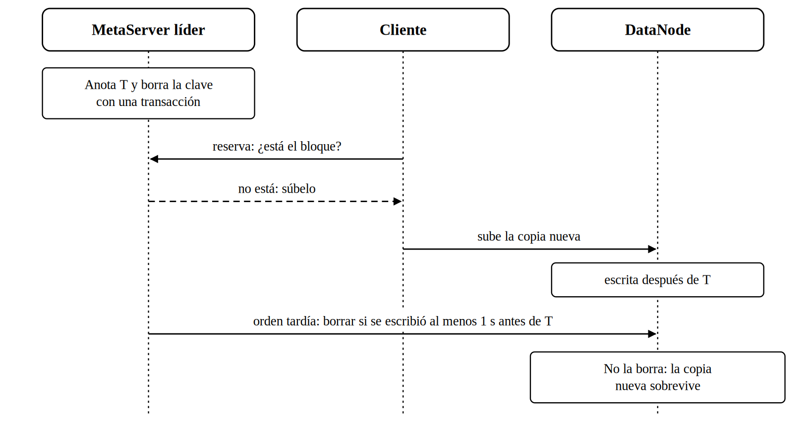
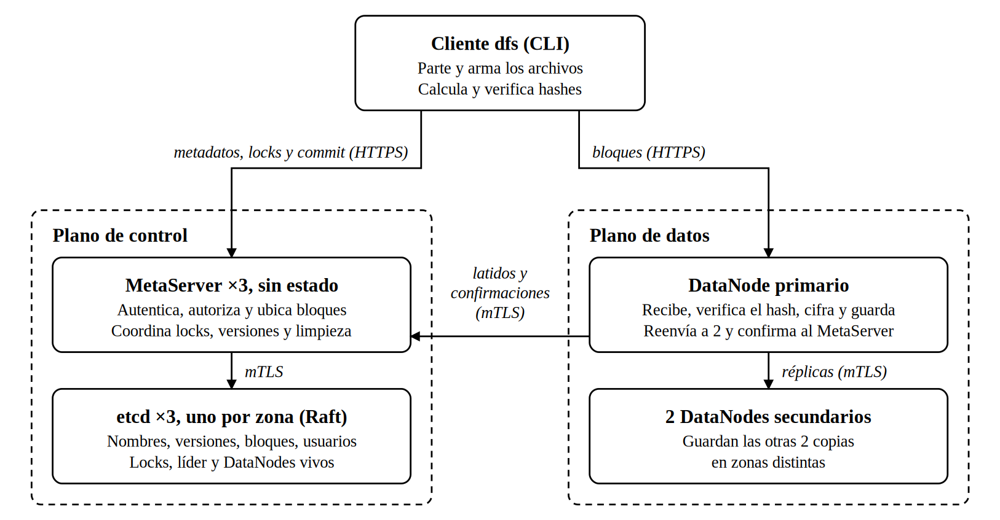
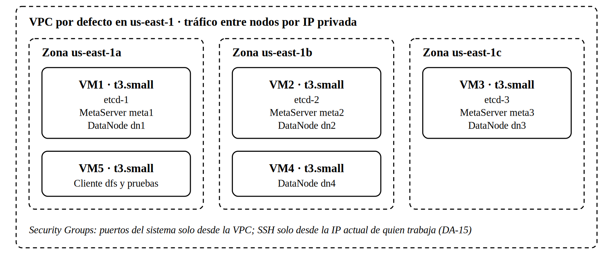

# DFSha · Fase II · Matriz comparativa y registro de decisiones

Sistemas Distribuidos 2026-2 · UPB · Opción 1: cliente/servidor con servicio distribuido entre servidores (S2S).

Equipo: Edwin David Vélez Rodríguez (000553569) · José Elías Díaz Marín (554108) · Santiago Andrés Martínez Lora (000554113). Medellín, noviembre de 2026.

> Copia en Markdown de `docs/DFSha_FaseII_Matriz_y_Decisiones_v5.pdf`, para que Claude Code la lea. Si cambia el Word, se regenera esta copia.

## 1. Propósito y criterios

Este documento fija la arquitectura común de la fase II del proyecto DFSha [1] a partir de las tres propuestas individuales [2], [3], [4]. Se mantiene la opción 1 del enunciado (cliente/servidor con servicio distribuido entre servidores), que usaron las tres propuestas.

Las decisiones se tomaron con cuatro criterios, en este orden:

1.  **Restricciones del laboratorio.** Lo que AWS Academy no permite no se puede entregar (sección 2).

2.  **Presupuesto.** US$50 para todo el semestre, incluidas las pruebas repetidas.

3.  **Tiempo y riesgo.** Usar lo que ya existe y está probado antes que programarlo desde cero.

4.  **Que los tres puedan explicarlo.** En la defensa el profesor pregunta a cualquiera; un diseño simple se defiende mejor.

Entre dos opciones equivalentes se prefiere la que más pesa en la rúbrica: RF1–RF3 funcionando (15 %) y alta disponibilidad, replicación y consistencia (15 %) son la mitad de la fase II.

## 2. Restricciones del entorno

El AWS Academy Learner Lab impone límites que descartan parte de las propuestas. La Tabla 1 resume los de la guía del Learner Lab en sus copias públicas de 2021 y 2024 [5], [6]; hay que confirmarlos en la guía de nuestro curso.

**Tabla 1.** Límites del AWS Academy Learner Lab.

| **Límite**                           | **Valor**                                                                               | **Efecto en el diseño**                                                                             |
|--------------------------------------|-----------------------------------------------------------------------------------------|-----------------------------------------------------------------------------------------------------|
| Instancias EC2 en ejecución a la vez | Máximo 9 por región; si se lanzan más, las sobrantes se terminan                        | Descarta el despliegue de 10 VMs (DA-13)                                                            |
| vCPU en ejecución a la vez           | Máximo 32                                                                               | 5 VMs t3.small usan 10                                                                              |
| Tipos de instancia                   | nano, micro, small, medium y large; solo bajo demanda                                   | t3.small está permitida                                                                             |
| Sesión de laboratorio                | 4 horas; al terminar, las VMs se detienen y se reinician al iniciar la siguiente sesión | La IP privada se conserva y la pública cambia (DA-11); el líder espera antes de re-replicar (DA-12) |
| Credenciales de la AWS CLI           | Cambian en cada sesión                                                                  | Los scripts las leen del archivo de credenciales (DA-15)                                            |
| Presupuesto                          | US$50                                                                                  | Estimación de costo en la sección 7                                                                 |

## 3. Matriz comparativa

Las tres propuestas comparten el esqueleto y difieren en los detalles de la Tabla 2. La última columna dice qué adopta el equipo y en qué decisión se justifica.

**En lo que coinciden las tres.** Plano de control separado del plano de datos; bloques que nunca se modifican y una versión nueva que se publica de una sola vez; tres réplicas confirmadas con dos en zonas distintas (W = 2); visibilidad al cerrar el archivo (close-to-open); sin truncado ni huecos; bloque recibido en un archivo temporal que se renombra al terminar; pases de bloque firmados; TLS 1.3 y mTLS con autoridad certificadora propia; y, ante una partición de red, consistencia antes que disponibilidad.

**Tabla 2.** Comparación de las propuestas individuales y elección del equipo.

| **Aspecto**                       | **Edwin**                                        | **José**                                        | **Santiago**                                        | **Equipo**                                               |
|-----------------------------------|--------------------------------------------------|-------------------------------------------------|-----------------------------------------------------|----------------------------------------------------------|
| Metadatos y consenso              | 2 MetaServers sin estado + etcd de 3 nodos       | 3 servidores sin estado + etcd de 3 nodos       | 3 MDS con Raft propio, sin etcd                     | 3 MetaServers + etcd (DA-01)                             |
| Identificador del bloque          | Hash SHA-256 del contenido                       | Id aleatorio                                    | Id aleatorio                                        | Hash SHA-256 (DA-02)                                     |
| Tamaño de bloque                  | 8 MiB                                            | 4 MiB                                           | 16 MiB                                              | 8 MiB, configurable (DA-03)                              |
| Envío de las copias               | Al primario, que reenvía a 2                     | El cliente envía a los 3                        | En cadena, DN a DN                                  | El primario reenvía (DA-04)                              |
| Quién registra las copias         | El primario confirma al MetaServer               | El cliente entrega confirmaciones firmadas      | Cada DN reporta al líder                            | El primario confirma (DA-04)                             |
| Ubicación de réplicas             | Turnos con inicio aleatorio, 2 zonas o más       | Los 3 nodos menos llenos, 2 zonas o más         | Más espacio libre con algo de azar, zonas distintas | Turnos con inicio aleatorio (DA-05)                      |
| Protocolo                         | REST/HTTPS en todo                               | REST para control, gRPC para datos              | gRPC en todo                                        | REST/HTTPS (DA-06)                                       |
| Lenguaje                          | Python (FastAPI)                                 | Node.js (Fastify)                               | No lo define                                        | Python, por confirmar (DA-07)                            |
| Lock                              | Por archivo, fila de etcd con espera             | Por archivo, 423 y reintento                    | Por rango de bloques, compartido o exclusivo        | Por archivo, fila con espera (DA-08)                     |
| Escritores a la vez en un archivo | 1                                                | 1                                               | Varios, en bloques distintos                        | 1 (DA-08)                                                |
| Qué valida el commit              | Versión base                                     | Versión base y lock vigente                     | Bloque base y lock vigente                          | Versión base y lock vigente (DA-08)                      |
| Cifrado en reposo                 | Lo hace el DataNode                              | Lo hace el cliente, clave por archivo           | Lo hace el cliente, clave por archivo               | Lo hace el DataNode (DA-09)                              |
| Contraseñas                       | bcrypt                                           | Argon2id                                        | Argon2id                                            | Argon2id (DA-10)                                         |
| Descubrimiento de nodos           | Nombres en /etc/hosts                            | DNS privado de Route 53                         | DNS privado de Route 53                             | Registro en etcd (DA-11)                                 |
| Detección de fallos               | Latido cada 5 s; caído a 15 s; re-réplica a 60 s | Latido cada 3 s; sospechoso a 9 s; caído a 30 s | Sospechoso en segundos; caído a 45 s                | Latido cada 5 s; caído a 15 s; re-réplica a 60 s (DA-12) |
| Despliegue                        | 5 VMs en 3 zonas                                 | 5 VMs en 3 zonas                                | 10 VMs en 3 zonas                                   | 5 VMs t3.small (DA-13)                                   |
| Modos de open()                   | r, w, a                                          | r, w, a, rw                                     | READ, WRITE, APPEND, READ_WRITE                     | r, w, a, rw (DA-14)                                      |
| Retención de la versión anterior  | 10 minutos                                       | 10 minutos                                      | Mientras haya lecturas abiertas                     | 10 minutos (DA-14)                                       |

## 4. Registro de decisiones

Las Tablas 3 a 18 registran cada decisión: qué se elige, qué se descarta y por qué, qué consecuencias trae para la implementación y de qué propuesta sale. DA-15 y DA-16 no vienen de ninguna propuesta: salen de lo que hace falta para desplegar y probar en AWS.

### DA-01 · Metadatos y consenso
- **Decisión:** Los metadatos viven en etcd, con 3 nodos (uno por zona). Tres MetaServers sin estado, uno en cada VM de control, atienden al cliente y leen y escriben en etcd. Solo los MetaServers hablan con etcd.
- **Se descarta:** Raft implementado dentro de los MDS (Santiago); dos MetaServers (Edwin).
- **Motivo:** etcd ya trae Raft, leases, transacciones, lock y elección de líder. Programar Raft y probarlo ante fallos es lo más costoso y propenso a errores. El tercer MetaServer no agrega VMs.
- **Consecuencias:** El MetaServer usa la pasarela HTTP/JSON de etcd [10] (rutas /v3/kv, /v3/lease, /v3/lock y /v3/election, con claves en base64), así no depende de clientes de etcd para Python. Sin mayoría de etcd, las operaciones responden 503.
- **Origen:** José, sobre la base de Edwin.

### DA-02 · Nombre del bloque y limpieza
- **Decisión:** Cada bloque se nombra con el hash SHA-256 de su contenido sin cifrar, dentro del espacio de cada usuario. En etcd la clave es /blocks/{usuario}/{hash}; en disco, el DataNode lo guarda en /data/{usuario}/{hash}.
- **Se descarta:** Id aleatorio por bloque (José y Santiago).
- **Motivo:** Reintentar un envío no crea copias distintas, una subida cortada se retoma, volver a subir un archivo con un bloque cambiado transfiere solo ese bloque, y el DataNode verifica la integridad comparando contenido y nombre.
- **Consecuencias:** Varias versiones pueden usar el mismo bloque, así que la limpieza no puede borrarlo a ciegas. El MetaServer líder la ejecuta cada 10 minutos: recorre los manifiestos de cada usuario, incluidas las versiones retenidas (DA-14), y toma como candidato un bloque que ninguno usa y cuya clave no cambió en la última hora, para no tocar subidas en curso. La reserva de una subida actualiza la clave de cada bloque que reutiliza. La limpieza anota el instante T justo antes de borrar la clave, y la borra con una transacción que falla si alguien la tocó después de revisarla. Después ordena borrar el archivo, y cada DataNode lo borra solo si lo escribió al menos 1 s antes de T. Si la limpieza ganó, la reserva ve el bloque como faltante y el cliente lo vuelve a subir; esa copia nueva sobrevive aunque la orden llegue tarde (Figura 1). El margen de 1 s cubre la diferencia entre los relojes de las VMs. Los tiempos son configurables (DA-16).
- **Origen:** Edwin; la regla de limpieza se completó al revisar el diseño en equipo.

**Figura 1.** Regla del instante T: la limpieza no borra una copia subida después de ella.

### DA-03 · Tamaño de bloque
- **Decisión:** 8 MiB por defecto, configurable al desplegar.
- **Se descarta:** 4 MiB (José) y 16 MiB (Santiago) como valor fijo.
- **Motivo:** Un archivo de 1 GiB queda en 128 bloques, suficiente para repartirlos y transferirlos en paralelo. La lista de hashes de un archivo cabe en un valor de etcd, cuyo límite por petición es 1,5 MiB.
- **Consecuencias:** Cambiar un byte reescribe 8 MiB. Comparar 4, 8 y 16 MiB queda como experimento opcional (sección 5).
- **Origen:** Edwin; las otras dos medidas quedan como variantes de prueba.

### DA-04 · Envío y registro de las copias
- **Decisión:** El cliente envía cada bloque al DataNode primario. Este lo recibe en un archivo temporal, verifica el hash, lo cifra, hace fsync y lo renombra. Luego reenvía el bloque sin cifrar a los 2 secundarios a la vez, por mTLS al puerto 9444, y cada uno lo verifica y lo cifra con su propia clave (DA-09). El primario espera hasta 10 s, le informa al MetaServer en qué DataNodes quedó y solo entonces le responde al cliente con esa lista.
- **Se descarta:** Que el cliente envíe a los 3 (José); réplica en cadena trozo a trozo (Santiago).
- **Motivo:** Enviar a los 3 triplica la subida del cliente y obliga a confiar en su reporte, que José resolvía con firmas. La cadena reenvía por trozos y es lo más difícil de cerrar ante fallos. Así el cliente envía una sola copia y la ubicación la registran los servidores.
- **Consecuencias:** El bloque se confirma con 2 copias en zonas distintas (W = 2). Si un secundario falla pero ya hay 2 copias en zonas distintas, el primario responde éxito y el líder repone la tercera (DA-12). Si no se logran 2 zonas, o si falla el primario, el cliente recibe un error reintentable, pide otros destinos (realloc) sin los nodos que fallaron y reenvía el mismo bloque, con el mismo nombre. W es configurable para medir el costo de la replicación (DA-16).
- **Origen:** Edwin; Santiago coincide en que los DataNodes reportan al plano de control.

### DA-05 · Ubicación de réplicas
- **Decisión:** El bloque i va al DataNode de la posición (inicio + i) mod N de la lista de DataNodes vivos y a los dos siguientes; inicio es aleatorio por archivo. El MetaServer salta los nodos sin espacio y verifica que el trío cubra al menos 2 zonas.
- **Se descarta:** Elegir los nodos menos llenos (José) o con más espacio libre (Santiago).
- **Motivo:** Reparte los bloques de un mismo archivo entre todos los nodos (RNF4) sin consultar el espacio en cada asignación. Con discos iguales, los nodos se llenan parejo.
- **Consecuencias:** Como solo la zona b tiene dos DataNodes, cualquier trío cubre al menos 2 zonas. Un nodo sin latido sale de la lista y no recibe bloques nuevos. Si solo quedan 2 DataNodes vivos en zonas distintas, como al caer la zona b, el bloque va a esos 2 y el líder repone la tercera copia cuando vuelva un nodo.
- **Origen:** Edwin.

### DA-06 · Protocolo
- **Decisión:** REST sobre HTTPS con FastAPI en todas las interfaces: JSON para control y cuerpo binario para bloques. Las rutas internas entre servidores van en puertos aparte con mTLS.
- **Se descarta:** gRPC para datos (José) o para todo (Santiago); RabbitMQ o Kafka, que descartaron los tres.
- **Motivo:** Un solo tipo de interfaz, se prueba con curl y el TLS es directo. Con bloques de 8 MiB no hace falta streaming. El contrato fijo que buscaba el .proto lo da OpenAPI, que FastAPI genera solo.
- **Consecuencias:** El DataNode lee el cuerpo por partes y calcula el hash mientras escribe el temporal, sin cargar el bloque entero en memoria. Los errores siguen el formato {error, message, retryable}.
- **Origen:** Edwin.

### DA-07 · Lenguaje
- **Decisión:** Python 3 con FastAPI para cliente, MetaServer y DataNode.
- **Se descarta:** Node.js con Fastify (José).
- **Motivo:** Un solo lenguaje para los tres componentes; FastAPI está entre las herramientas que sugiere el enunciado. hashlib y cryptography cubren SHA-256 y AES-GCM.
- **Consecuencias:** Se cierra con el lenguaje que los tres dominen mejor. Si se elige Node.js, las demás decisiones se mantienen.
- **Origen:** Edwin.

### DA-08 · Lock y control de versiones
- **Decisión:** lock(ruta, espera) usa el lock de etcd: los escritores esperan en fila y entran en orden de llegada. Cada intento usa su propio lease de 30 s, que el cliente renueva cada 10 s. Si la espera se agota, o se pidió espera 0, responde 423 y el MetaServer revoca el lease de ese intento para sacarlo de la fila. El commit es una transacción de etcd que exige que la versión base siga siendo la actual y que la clave del lock siga existiendo; si no, responde 409.
- **Se descarta:** Locks por rango de bloques y varios escritores por archivo (Santiago); 423 inmediato con reintento del cliente (José), que queda como el caso de espera 0.
- **Motivo:** La publicación es por archivo. Los rangos exigen detectar solapamientos y comparar bloque a bloque en el commit. Comprobar también el lock impide que publique un escritor cuyo lock venció mientras otro ya está escribiendo.
- **Consecuencias:** Un escritor por archivo a la vez, lo que limita la concurrencia de escritura dentro de un archivo (RNF5). Los lectores no se bloquean y los bloques de un archivo viajan en paralelo.
- **Origen:** Edwin, con la comprobación del lock de José.

### DA-09 · Cifrado en reposo
- **Decisión:** El DataNode cifra cada bloque con AES-256-GCM antes de guardarlo, con una clave por nodo que no está en el disco de datos. Los discos EBS se crean cifrados.
- **Se descarta:** Cifrado en el cliente con clave por archivo (José y Santiago).
- **Motivo:** No hay que guardar ni repartir claves por archivo. Si el cliente cifrara con un nonce aleatorio, el mismo bloque daría un hash distinto en cada envío y se perdería DA-02.
- **Consecuencias:** Entre DataNodes el bloque viaja sin cifrar dentro de mTLS, y cada uno lo cifra con su propia clave, también en la re-réplica. Costo: el proceso DataNode ve los datos en claro mientras los procesa.
- **Origen:** Edwin.

### DA-10 · Autenticación y autorización
- **Decisión:** Contraseñas guardadas con Argon2id. El login entrega un JWT firmado que vence en 1 hora. El MetaServer solo permite rutas dentro del espacio del usuario del token. Para cada bloque entrega un pase firmado con HMAC (hash, operación, usuario y vencimiento de 10 minutos) que el DataNode verifica sin consultarlo.
- **Se descarta:** bcrypt (Edwin); token de refresco (Santiago); JWT de 15 minutos (José).
- **Motivo:** Argon2id lo eligieron dos de tres propuestas. Un JWT de 1 hora cubre una sesión de pruebas sin agregar rutas de refresco.
- **Consecuencias:** La clave del JWT, la del HMAC de los pases, las claves de cifrado de los DataNodes y los certificados los genera un script fuera del repositorio y llegan a cada contenedor como secretos de Docker (DA-15). Como el repositorio es público, nunca se suben. Un usuario administrador, creado por el mismo script, es el único que puede consultar el estado del sistema (DA-16).
- **Origen:** José y Santiago (Argon2id); Edwin (pases).

### DA-11 · Descubrimiento y nombres
- **Decisión:** Cada DataNode se registra al arrancar a través de cualquier MetaServer, con su IP privada, puerto, zona y espacio libre; el MetaServer guarda el registro en etcd, en una clave atada al lease de latidos del nodo (DA-12). Los MetaServers también se registran en etcd. El cliente y los DataNodes tienen en su configuración las IP privadas de los 3 MetaServers y las prueban en orden hasta que una responde; con ella piden la lista actual. Al abrir un archivo o reservar bloques, el MetaServer le entrega al cliente la dirección IP:puerto de los DataNodes de cada bloque.
- **Se descarta:** Nombres fijos en /etc/hosts (Edwin); DNS privado de Route 53 como requisito (José y Santiago); un solo punto de entrada.
- **Motivo:** RNF7 pide que el cliente no tenga direcciones de nodos fijas: solo sabe cómo llegar al plano de control y descubre los DataNodes en cada apertura. Un DataNode nuevo empieza a recibir bloques desde su primer latido. Con tres entradas, el cliente arranca aunque un MetaServer esté caído. No depende de Route 53, y la IP privada se conserva cuando el laboratorio detiene y reinicia la VM.
- **Consecuencias:** El script de despliegue escribe las 3 IP en la configuración y emite el certificado de cada nodo con su IP privada. etcd y los MetaServers se configuran entre sí con las IP privadas. Si se borra y se vuelve a crear una VM, su IP cambia y hay que correr de nuevo el script. Si el laboratorio permite Route 53, la lista se reemplaza por un nombre sin tocar el código.
- **Origen:** José y Santiago (descubrimiento dinámico).

### DA-12 · Detección de fallos y recuperación
- **Decisión:** Cada DataNode envía un latido cada 5 s a cualquier MetaServer por el puerto 8444, y ese MetaServer renueva la clave del nodo en etcd, atada a un lease de 15 s. Si la clave vence, el nodo sale de la lista y no recibe bloques nuevos. Si sigue caído a los 60 s, el MetaServer líder ordena copiar sus bloques desde otra réplica hasta volver a 3 copias; también repone la tercera copia de los bloques que se confirmaron con 2 (DA-04). El líder se elige con el servicio de elección de etcd. Las órdenes de copiar o borrar se guardan en etcd en /orders/{nodo}; el DataNode las recibe en la respuesta a su latido y avisa en el siguiente cuando las cumplió.
- **Se descarta:** Re-replicar en cuanto falta un latido.
- **Motivo:** Un nodo que solo se reinició vuelve rápido; copiar todos sus bloques por una pausa corta gasta red. Las tres propuestas usan dos pasos, con tiempos distintos.
- **Consecuencias:** Si el nodo vuelve, sus bloques vigentes cuentan otra vez y la limpieza borra las copias que sobren. Como las órdenes están en etcd, un cambio de líder no las pierde y un DataNode caído las recibe al volver. Al iniciar cada sesión del laboratorio las VMs arrancan en momentos distintos, así que el líder espera 5 minutos desde que gana la elección antes de re-replicar; sin esa espera copiaría los bloques de cada nodo que tarde en arrancar. Por lo mismo, si cae a la vez el líder y un DataNode (por ejemplo, al apagar su zona), la re-réplica empieza a los 5 minutos; la lectura y la escritura no se detienen.
- **Origen:** Edwin, con los dos pasos de José y Santiago.

### DA-13 · Despliegue
- **Decisión:** 5 VMs EC2 t3.small en 3 zonas de us-east-1, en la VPC por defecto (que ya trae una subred por zona), con Docker Compose y red del host (network_mode: host). Tres VMs de control, una por zona, con etcd, MetaServer y DataNode; una VM con el cuarto DataNode en la zona b; y una VM para el cliente y las pruebas en la zona a. Disco gp3 de 20 GiB por VM, cifrado, y en las tres VMs de control un volumen gp3 aparte de 4 GiB para los datos de etcd.
- **Se descarta:** 10 VMs con DataNodes t3.medium (Santiago), cuya alternativa de 2 DataNodes por VM se parece a lo adoptado; cliente en t3.micro (Edwin).
- **Motivo:** El Learner Lab permite como máximo 9 instancias a la vez, así que 10 VMs no se pueden desplegar. 5 VMs caben en US$50 con margen (sección 7). Las 3 zonas permiten probar la caída de una zona completa. El cliente mide el rendimiento, y una t3.micro, con la mitad de memoria y menos CPU sostenida, podría ser el cuello de botella de las mediciones.
- **Consecuencias:** Cada servicio usa puertos propios: etcd 2379 y 2380, MetaServer 8443 y 8444 (interno), DataNode 9443 y 9444 (interno). Las IP públicas sirven para SSH y para descargar paquetes, imágenes y el repositorio, porque la VPC por defecto no tiene NAT; los puertos del sistema solo se abren dentro de la VPC. etcd va en su propio volumen porque es muy sensible a la lentitud del disco: los fsync de bloques de 8 MiB del DataNode podrían retrasar sus latidos y provocar elecciones de líder sin que nada haya fallado. Por lo mismo, su intervalo de latido sube a 250 ms y su tiempo de elección a 2,5 s. El script de despliegue crea, formatea y monta ese volumen (DA-15).
- **Origen:** Edwin y José.

### DA-14 · Semántica de open(), read() y write()
- **Decisión:** open(ruta, modo) con cuatro modos: r lee; w crea o reemplaza; a anexa al final; rw modifica partes. w, a y rw toman el lock. read() lee la versión que había al abrir, más los cambios propios aún no publicados. write(fd, offset, datos) acepta offsets entre 0 y el tamaño actual y reescribe completos los bloques que toca. close() publica la versión nueva. La versión reemplazada se conserva 10 minutos.
- **Se descarta:** Semántica POSIX completa; truncado y huecos; conservar la versión mientras haya lectores abiertos (Santiago).
- **Motivo:** Es lo que RF3 pide declarar, con una regla que se puede probar. Un plazo fijo es más simple que rastrear sesiones de lectura.
- **Consecuencias:** Un lector que tarde más de 10 minutos debe reabrir el archivo.
- **Origen:** José y Santiago (modos); Edwin y José (10 minutos).

### DA-15 · Despliegue reproducible
- **Decisión:** Todo el despliegue sale del repositorio público con cuatro scripts de bash que usan la AWS CLI: uno crea el grupo de seguridad y las 5 VMs en sus zonas; otro agrega a la regla de SSH la IP actual de quien trabaja; otro borra todo; y otro despliega. Al crearse, cada VM instala Docker y clona el repositorio (user-data). El script de despliegue genera en la máquina de quien lo corre la autoridad certificadora, los certificados de cada nodo y los secretos; los copia a cada VM por scp; y en cada VM actualiza el repositorio (git pull) y levanta los contenedores con docker compose up --build.
- **Se descarta:** Crear la infraestructura a mano en la consola; un registro de imágenes (ECR o Docker Hub); un repositorio privado, que obligaría a guardar credenciales en las VMs.
- **Motivo:** Con scripts, cualquiera de los tres levanta, actualiza y borra el sistema de la misma forma, y el README del entregable describe exactamente esos pasos. Un repositorio público se clona sin credenciales, y construir en cada VM evita mantener otro servicio.
- **Consecuencias:** Como el repositorio es público, nada secreto puede entrar en él: claves, certificados, archivos .env, la llave labsuser.pem ni las credenciales de AWS. El .gitignore los excluye desde el primer commit. Las credenciales del Learner Lab cambian en cada sesión: se copian del panel AWS Details al archivo de credenciales de la AWS CLI antes de correr los scripts. En Windows, los scripts se corren desde WSL o Git Bash.
- **Origen:** Definida por el equipo al revisar el diseño.

### DA-16 · Tiempos configurables y estado observable
- **Decisión:** Todos los tiempos y umbrales se leen de variables de entorno, con un valor normal y otro corto para las pruebas (Tabla 19). El MetaServer expone GET /admin/status, y el cliente el comando dfs status, con el líder actual, los nodos vivos y su zona, los bloques con menos de 3 copias y las órdenes pendientes; dfs stat --blocks ruta muestra en qué DataNodes está cada bloque de un archivo.
- **Se descarta:** Tiempos fijos en el código; revisar el estado leyendo etcd o los logs a mano.
- **Motivo:** Con los valores normales, algunas pruebas tardarían 5 minutos (la espera del líder) o más de una hora (la limpieza). Las pruebas del enunciado piden evidencias que se puedan ver, y esta ruta las muestra sin herramientas extra.
- **Consecuencias:** Cada prueba declara qué valores usa. /admin/status solo responde al usuario administrador (DA-10).
- **Origen:** Definida por el equipo al revisar el diseño.

**Tabla 19.** Variables de tiempo y umbrales (DA-16).

| **Variable**            | **Qué controla**                                    | **Normal** | **Pruebas** |
|-------------------------|-----------------------------------------------------|------------|-------------|
| DFS_BLOCK_MIB           | Tamaño de bloque (DA-03)                            | 8          | 8           |
| DFS_W                   | Copias para confirmar un bloque (DA-04)             | 2          | 2 o 3       |
| DFS_PRIMARY_WAIT_S      | Espera del primario por los secundarios (DA-04)     | 10         | 10          |
| DFS_LOCK_LEASE_S        | Lease de cada intento de lock (DA-08)               | 30         | 30          |
| DFS_HEARTBEAT_S         | Intervalo de latido de los DataNodes (DA-12)        | 5          | 5           |
| DFS_NODE_LEASE_S        | Vencimiento de un nodo sin latidos (DA-12)          | 15         | 15          |
| DFS_REREPLICATE_AFTER_S | Espera antes de re-replicar (DA-12)                 | 60         | 60          |
| DFS_LEADER_GRACE_S      | Espera del líder nuevo antes de re-replicar (DA-12) | 300        | 60          |
| DFS_RETENTION_S         | Retención de la versión anterior (DA-14)            | 600        | 60          |
| DFS_GC_INTERVAL_S       | Cada cuánto corre la limpieza (DA-02)               | 600        | 30          |
| DFS_GC_MIN_AGE_S        | Tiempo sin cambios para ser candidato (DA-02)       | 3600       | 120         |

## 5. Garantías y cómo se demostrarán

Cada garantía está escrita para que una prueba la pueda confirmar o refutar, como pide el numeral 7 del enunciado [1]. La Tabla 20 las resume y la Tabla 21 muestra cómo se demuestra cada prueba mínima; las de fallos se separan por caso, porque cada uno tiene un resultado esperado distinto.

**Tabla 20.** Garantías de consistencia.

| **Garantía**               | **Enunciado**                                                                                                                                                                 |
|----------------------------|-------------------------------------------------------------------------------------------------------------------------------------------------------------------------------|
| G1 Confirmación            | close() o put responden éxito solo si cada bloque nuevo está en disco en al menos 2 DataNodes de zonas distintas, con hash verificado, y la versión quedó registrada en etcd. |
| G2 Atomicidad              | Un lector ve la versión v completa o la v+1 completa, nunca una mezcla.                                                                                                       |
| G3 Close-to-open           | Todo open() posterior a un close() exitoso ve esa versión o una más reciente.                                                                                                 |
| G4 Sin escrituras perdidas | Un commit con versión base desactualizada o con el lock vencido se rechaza con 409.                                                                                           |
| G5 Durabilidad             | Lo confirmado sobrevive a la caída de un DataNode o de una zona completa, y a la de dos DataNodes cuando el líder ya repuso la tercera copia.                                 |

**Tabla 21.** Pruebas mínimas y resultado esperado.

| **Prueba**                 | **Cómo se demuestra y qué se espera**                                                                                                                                                                     | **Comprueba**    |
|----------------------------|-----------------------------------------------------------------------------------------------------------------------------------------------------------------------------------------------------------|------------------|
| Carga y recuperación       | put de un archivo de 512 MiB; dfs stat --blocks muestra los bloques repartidos en los 4 DataNodes; get y comparar el SHA-256 con el original.                                                             | G1, DA-05        |
| Acceso RF3                 | open en rw, write en un offset dentro de un bloque y close; un segundo cliente lee antes y después del close.                                                                                             | G2, G3, DA-14    |
| Concurrencia               | Dos clientes abren el mismo archivo en w. Con espera, el segundo entra después del primero y parte de su versión; con espera 0 recibe 423; un commit tardío con el lock vencido recibe 409.               | G4, DA-08        |
| Fallos: un DataNode        | Detener dn4 durante get y durante put: las operaciones terminan bien y dfs status muestra la tercera copia repuesta a los ≈ 60 s.                                                                         | G5, DA-12        |
| Fallos: zona c             | Revisar con dfs status que el líder no esté en la zona c y detener la VM3: se sigue leyendo y escribiendo, y la tercera copia vuelve a los ≈ 60 s.                                                        | G5, DA-05, DA-12 |
| Fallos: zona b             | Detener la VM2 y la VM4: se sigue leyendo y escribiendo con 2 copias (dn1 y dn3); la tercera vuelve cuando la zona vuelve.                                                                                | G5, DA-05        |
| Fallos: reinicio de sesión | Terminar e iniciar la sesión del laboratorio: no hay re-réplicas durante la espera del líder.                                                                                                             | DA-12            |
| Consistencia               | Bloquear con iptables el tráfico hacia un secundario durante un put; los lectores ven la versión anterior hasta el commit y la nueva después.                                                             | G1, G2           |
| Seguridad                  | Sin token: 401; ruta o pase de otro usuario: 403; tcpdump muestra solo tráfico TLS; un bloque leído directo del disco de un DataNode es ilegible.                                                         | DA-09, DA-10     |
| Rendimiento                | Latencia (mediana y percentil 95) y throughput de put y get en tres comparaciones: tamaño de archivo (1, 64 y 512 MiB); 1 frente a 4 clientes a la vez desde la VM5; y confirmar con 2 frente a 3 copias. | DA-03, DA-04     |

Cada condición se repite 5 veces con un script, verificando el SHA-256 en cada repetición. Quedan como opcionales, si sobran tiempo y presupuesto: 1, 4 y 8 bloques en paralelo; 3 frente a 4 DataNodes; bloques de 4, 8 y 16 MiB; y la carrera entre una subida y la limpieza de un bloque idéntico.

## 6. Arquitectura acordada

Un plano de control (3 MetaServers y etcd) decide dónde va cada bloque, y un plano de datos (4 DataNodes) los guarda. El cliente solo pregunta a los MetaServers; los bytes van directo a los DataNodes (Figura 2).

**Figura 2.** Componentes y canales.

Todo el tráfico usa TLS 1.3; entre servidores, TLS mutuo. El canal de latidos también funciona en sentido contrario: en la respuesta a cada latido, el DataNode recibe las órdenes de copiar o borrar bloques (DA-12). Como solo la zona b tiene dos DataNodes, las 3 copias de cada bloque quedan en al menos 2 zonas (Figura 3).

**Figura 3.** Despliegue en AWS Academy.

## 7. Estimación de costo

Con 5 VMs t3.small, los US$50 alcanzan para unas 250 horas de laboratorio contando discos, IP públicas y tráfico (Tabla 22). El despliegue de 10 VMs, además de pasar el límite de 9 instancias, gastaría unos US$36 solo en discos durante 6 semanas.

**Tabla 22.** Costo estimado del despliegue.

| **Concepto**                                                                       | **Equipo (DA-13)**                                | **Propuesta de 10 VMs**                    |
|------------------------------------------------------------------------------------|---------------------------------------------------|--------------------------------------------|
| VMs                                                                                | 5 × t3.small                                      | 4 × t3.small + 6 × t3.medium               |
| Costo de las VMs por hora encendidas                                               | US$0,104                                         | US$0,333                                  |
| IP públicas por hora encendidas (US$0,005 cada una)                               | US$0,025                                         | US$0,050                                  |
| Discos gp3 (se cobran aunque las VMs estén detenidas)                              | 112 GiB, incluidos 12 GiB de etcd: ≈ US$9 al mes | 300 GiB solo en DataNodes: ≈ US$24 al mes |
| ¿Cabe en el límite de 9 instancias?                                                | Sí                                                | No                                         |
| Horas de laboratorio que alcanzan, con 6 semanas de discos y unos US$5 de tráfico | ≈ 250 horas                                       | Menos de 30 horas                          |

Supuestos: precios bajo demanda de us-east-1 para Linux (t3.small US$0,0208/h; t3.medium US$0,0416/h; gp3 US$0,08 por GB-mes) [7], [8]. El tráfico entre zonas también se cobra por GB, aproximadamente US$0,01 en cada sentido. Desde febrero de 2024 AWS cobra cada IPv4 pública a US$0,005 por hora [9]; hay que confirmar si el Learner Lab lo descuenta del presupuesto. Las T3 arrancan en modo unlimited: si la CPU pasa mucho tiempo por encima de su línea base, AWS cobra US$0,05 por vCPU-hora adicional [7].

Para cuidar el presupuesto: terminar la sesión del laboratorio al acabar de trabajar, para que las VMs se detengan, y borrar VMs y discos al cerrar el proyecto con el script de borrado (DA-15).

## 8. Cambios frente a cada diseño individual

La arquitectura acordada queda más cerca de la propuesta de Edwin, que cambia en 7 puntos; la de José cambia en 10 y la de Santiago en 12 (Tabla 23). El motivo de cada cambio está en la decisión indicada. DA-15 y DA-16 son nuevas para los tres.

**Tabla 23.** Cambios frente a cada diseño individual.

| **Diseño** | **Antes**                                                        | **Ahora**                                                                        | **Decisión** |
|------------|------------------------------------------------------------------|----------------------------------------------------------------------------------|--------------|
| Edwin      | 2 MetaServers                                                    | 3 MetaServers, uno por zona                                                      | DA-01        |
| Edwin      | Limpieza sin regla ante la reutilización simultánea de un bloque | Borrado con transacción condicionada y solo de copias escritas antes del borrado | DA-02        |
| Edwin      | El commit valida solo la versión base                            | Valida versión base y lock vigente                                               | DA-08        |
| Edwin      | Contraseñas con bcrypt                                           | Argon2id                                                                         | DA-10        |
| Edwin      | Nombres en /etc/hosts                                            | Registro de los nodos en etcd y lista de 3 MetaServers                           | DA-11        |
| Edwin      | Cliente en t3.micro                                              | Cliente en t3.small                                                              | DA-13        |
| Edwin      | Modos r, w y a                                                   | Se agrega rw para modificar partes                                               | DA-14        |
| José       | Id aleatorio por bloque                                          | Hash SHA-256 como nombre                                                         | DA-02        |
| José       | Bloques de 4 MiB                                                 | 8 MiB; 4 MiB queda como variante de prueba                                       | DA-03        |
| José       | El cliente envía a 3 nodos y entrega confirmaciones firmadas     | El primario reenvía y confirma al MetaServer                                     | DA-04        |
| José       | Los 3 nodos menos llenos                                         | Turnos con inicio aleatorio                                                      | DA-05        |
| José       | gRPC para los bloques                                            | REST sobre HTTPS                                                                 | DA-06        |
| José       | Node.js con Fastify                                              | Python con FastAPI, por confirmar                                                | DA-07        |
| José       | 423 y reintento con espera creciente                             | Fila de etcd; 423 solo si se pide espera 0                                       | DA-08        |
| José       | El cliente cifra con clave por archivo                           | El DataNode cifra con clave por nodo                                             | DA-09        |
| José       | JWT de 15 minutos                                                | JWT de 1 hora                                                                    | DA-10        |
| José       | DNS privado de Route 53                                          | Registro en etcd; Route 53 opcional                                              | DA-11        |
| Santiago   | Raft implementado dentro de los MDS                              | etcd                                                                             | DA-01        |
| Santiago   | Id aleatorio por bloque                                          | Hash SHA-256 como nombre                                                         | DA-02        |
| Santiago   | Bloques de 16 MiB                                                | 8 MiB; 16 MiB queda como variante de prueba                                      | DA-03        |
| Santiago   | Réplica en cadena                                                | El primario reenvía a 2                                                          | DA-04        |
| Santiago   | Más espacio libre con algo de azar                               | Turnos con inicio aleatorio                                                      | DA-05        |
| Santiago   | gRPC en todo                                                     | REST sobre HTTPS                                                                 | DA-06        |
| Santiago   | Locks por rango, varios escritores y commit por bloque base      | Un escritor por archivo; commit por versión base y lock                          | DA-08        |
| Santiago   | El cliente cifra con clave por archivo                           | El DataNode cifra con clave por nodo                                             | DA-09        |
| Santiago   | JWT corto con token de refresco                                  | JWT de 1 hora, sin refresco                                                      | DA-10        |
| Santiago   | DNS privado de Route 53                                          | Registro en etcd; Route 53 opcional                                              | DA-11        |
| Santiago   | 10 VMs con DataNodes t3.medium, o 2 DataNodes por VM             | 5 VMs t3.small                                                                   | DA-13        |
| Santiago   | Versión retenida mientras haya lectores                          | Versión retenida 10 minutos                                                      | DA-14        |

## Referencias

1.  Ospina Sanjuan, A. (2026). Proyecto 1 · DFSha: diseño e implementación de un sistema de archivos distribuido. Sistemas Distribuidos 2026-2, UPB.

2.  Vélez Rodríguez, E. D. (2026). Proyecto DFSha: diseño de un sistema de archivos distribuido con alta disponibilidad, rendimiento y seguridad. Fase I.

3.  Díaz Marín, J. E. (2026). DFSha: sistema de archivos distribuido con alta disponibilidad. Fase I.

4.  Martínez Lora, S. A. (2026). DFSha: sistema de archivos distribuido con alta disponibilidad, rendimiento y seguridad. Fase I.

5.  AWS Academy. Learner Lab, guía del entorno (instrucciones actualizadas el 6 de agosto de 2024). Copia en https://studylib.net/doc/27689384/aws-learner-lab

6.  AWS Academy. Learner Lab – Foundation Services (2021). Copia en https://cyberlab.pacific.edu/courses/comp175/resources/aws-academy/AWS_Academy_Learner_Lab-Foundational_Services.pdf

7.  Amazon Web Services. Amazon EC2 T3 Instances. https://aws.amazon.com/ec2/instance-types/t3/

8.  Amazon Web Services. Amazon EBS pricing. https://aws.amazon.com/ebs/pricing

9.  Barr, J. (2023). New – AWS Public IPv4 Address Charge + Public IP Insights. AWS News Blog. https://aws.amazon.com/blogs/aws/new-aws-public-ipv4-address-charge-public-ip-insights/

10. etcd Authors. etcd v3 documentation. https://etcd.io/docs/
